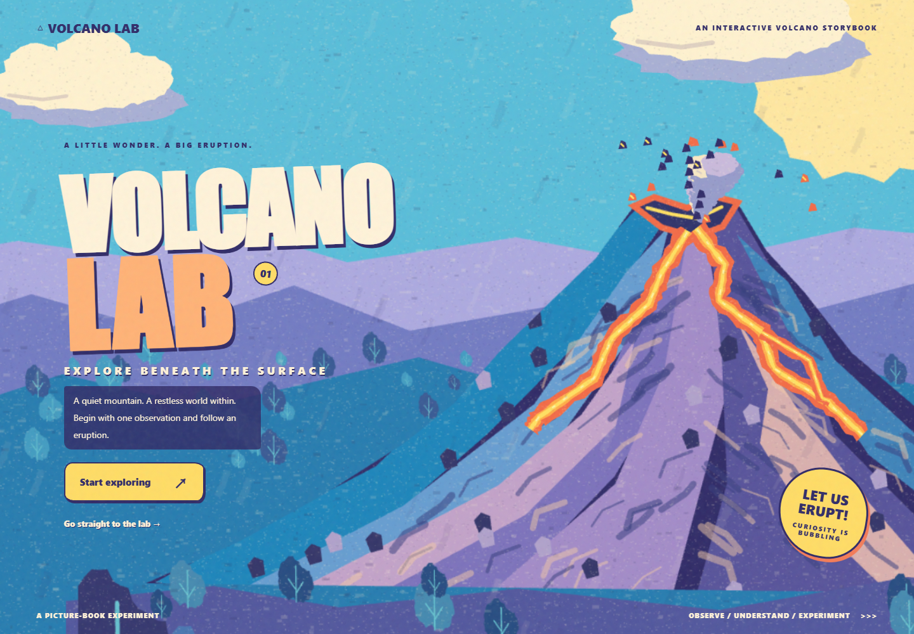
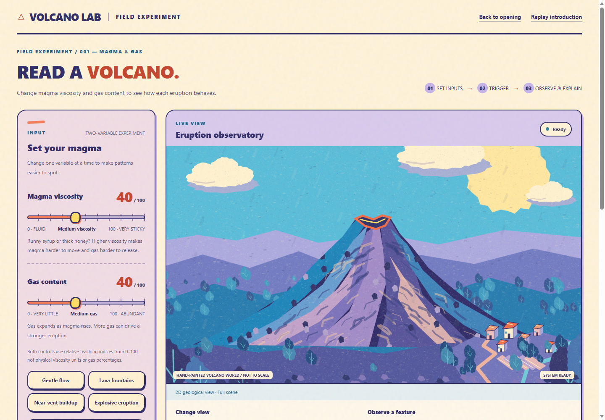
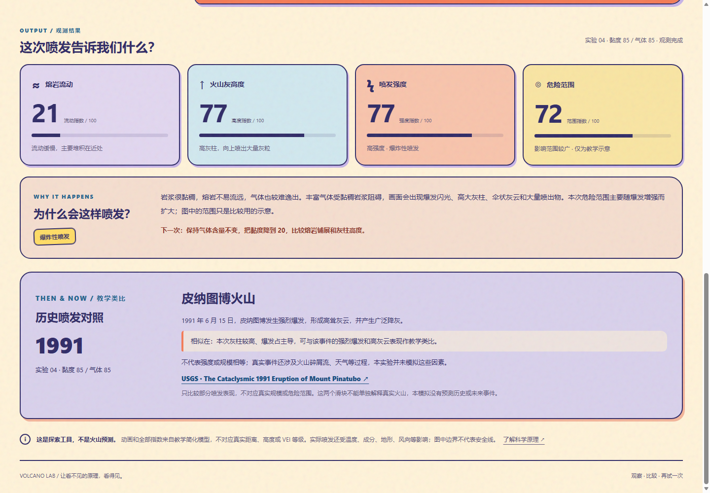

# Volcano Lab

**Current project · PFAD Assignment 3 · Cai Zhichun**

A colorful, hand-painted 2D interactive volcano laboratory. Explore a short illustrated opening and guided lessons, then adjust magma viscosity and gas content to see how they change an eruption.

## ▶ Play the current version

**[Launch Volcano Lab in your browser](https://heyouu5544.github.io/volcano-lab/volcano-lab/)**<br>
[Go directly to the experiment](https://heyouu5544.github.io/volcano-lab/volcano-lab/lab.html)

[View the Volcano Lab repository](https://github.com/heyouu5544/volcano-lab)

No installation is needed for the online version. The current project lives in **[`volcano-lab/`](./volcano-lab/)**.



## What to try

1. Choose **Start exploring** to watch the illustrated opening and read the five short lessons. You can skip or replay the introduction.
2. Adjust **magma viscosity** and **gas content**, or choose a preset combination.
3. Select **Trigger eruption** and observe the lava, ash cloud, eruption intensity, and hazard-range indicators.
4. Compare the explanation and historical eruption analogy with the visual result.
5. Explore the crater, ash cloud, lava flow, village, or mountain cross-section. Use **Reset** to start again.

During an eruption, controls prevent overlapping runs and explain repeated trigger attempts. Reset can cancel the current experiment. Keyboard controls and a responsive mobile layout are included.





## Project documents

- [Current source code and full running instructions](./volcano-lab/)
- [Current development process, user testing, and iteration](./volcano-lab/PROCESS.md)
- [Asset sources, original artwork, and credits](./volcano-lab/ASSETS.md)
- [Developer verification and screenshots](./volcano-lab/VERIFICATION.md)

## User Testing

- Liu Ling found that some buttons did not respond clearly enough and that the reaction after clicking felt slow. The revision added immediate pressed and selected states, instant status updates, a visible running state for **Trigger eruption**, a message for repeated clicks during an eruption, and a **Reset** action that can cancel the current experiment.
- Yin Shiqi felt that the original black-and-white visual style did not suit an educational interactive experience. This feedback led to the colorful hand-painted 2D redesign across the opening cinematic, teaching dialogue, volcano scene, controls, buttons, result panels, and observation interface.

These revisions were based on participant feedback. Participant retesting after the revisions has not yet been documented. Automated checks remain separate from participant evidence.

## Run locally

Download or clone this repository, then run from the repository root:

```sh
node volcano-lab/serve.cjs
```

Open `http://127.0.0.1:4173/`. The project uses native HTML, CSS, JavaScript, and Canvas with no npm runtime dependencies. You can also open `volcano-lab/index.html` directly.

## Educational model

The sliders and result indicators are relative teaching indices. They are not real gas percentages, physical heights or distances, VEI measurements, or real safety boundaries. Historical cases illustrate similarities in eruption behavior; two parameters cannot reproduce or predict a real eruption.

## Development history

Earlier prototypes, files, and all previous commits remain preserved in Git history. The current project is **Volcano Lab**; use `volcano-lab/` and the links above for the current submission.

---

The current submission is the colorful, hand-painted 2D Volcano Lab. Current source, process notes, credits, and verification are in `volcano-lab/`; earlier artifacts remain available through Git history.
