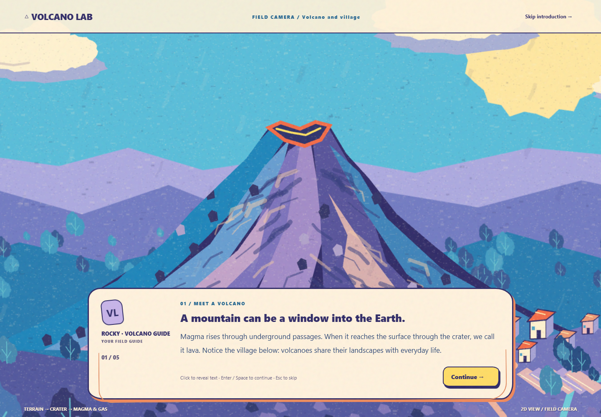

# Volcano Lab · A Colorful Interactive Storybook

Begin on an animated volcano cover, travel through a layered parallax opening and five short lessons, then explore how magma viscosity and gas content change an eruption. Lake blue skies, blue-violet rock layers, coral-orange and yellow lava, and cream-colored clouds share one hand-painted 2D world.

This is the current project in [`heyouu5544/volcano-lab`](https://github.com/heyouu5544/volcano-lab). Work was completed in the actual Git checkout rather than a separate preview copy. The repository's full history remains intact.

## Play online

- [Launch the storybook opening](https://heyouu5544.github.io/volcano-lab/volcano-lab/)
- [Go directly to the experiment](https://heyouu5544.github.io/volcano-lab/volcano-lab/lab.html)





## Run locally

From the repository root:

```powershell
node volcano-lab/serve.cjs
```

Open <http://127.0.0.1:4173/> for the opening or <http://127.0.0.1:4173/lab.html> for the lab. The project uses native HTML, CSS, JavaScript, and Canvas, with no npm runtime dependency or external font.

The startup log prints the absolute `Serving project` path. Visit <http://127.0.0.1:4173/__preview.json> to verify the served root, entry file, and SHA-256 hash. Responses also include `X-Volcano-Lab-Root`.

## Experience and retained features

- Start with a roughly nine-second illustrated camera journey through distant terrain, the village, mountain slopes, crater, and cutaway. The tour and lessons can be skipped or replayed.
- Five focused dialogue chapters introduce volcanoes, viscosity, gas content, experiment controls, and the comparison task. Click once to reveal the current paragraph, then again to continue. Enter and Space continue; Escape skips to the lab.
- Two 0–100 sliders provide tick labels, live values, and keyboard control. Four presets show visible selected states.
- Trigger eruption runs an 8.5-second sequence with pressure buildup, release, and settling. Inputs lock during the run, repeat triggers produce a clear notice, and Reset can cancel at any time.
- Low viscosity creates fast, branching, long-distance flows. High viscosity creates short, thick flows and near-vent buildup. High gas increases fountains, ash, ejecta, and explosive activity.
- Crater, ash cloud, lava flow, and village observations move or zoom the camera, highlight the target, and update the explanation. A full-scene view and volcano cutaway remain available.
- Results include four indices, a plain-language explanation, a next-experiment suggestion, and a sourced analogy to Maunaulu, Mount St. Helens, or Mount Pinatubo when the match is responsible.
- The mobile layout places the scene before controls and avoids relying on imagery alone for results.

## Files

| File | Purpose |
| --- | --- |
| `index.html` / `lab.html` | Storybook opening / direct experiment entry |
| `storybook.css` | Hand-painted UI, dialogue, states, and responsive layout |
| `js/scene.js` | Original terrain, vegetation, village, clouds, texture, parallax, and eruption animation |
| `js/story.js` | Opening shots, typed dialogue, keyboard controls, skip, and replay |
| `js/app.js` / `js/observer.js` | Experiment lifecycle, results, Reset, and observation tools |
| `js/model.js` / `js/history.js` | Teaching model, historical sources, and matching rules |
| `ASSETS.md` | Artwork, reference, and science credits |
| `VERIFICATION.md` | Current developer verification and screenshot index |

Earlier CSS, 3D scripts, and JPG screenshots remain as historical artifacts. The current entry points load `storybook.css` and the scripts listed in their HTML.

## User Testing

- Liu Ling found that some buttons did not respond clearly enough and that the response after clicking felt slow. The revision now shows immediate pressed and selected states, updates status text as soon as an action starts, changes **Trigger eruption** to a visible running state, explains repeated clicks during an eruption, and allows **Reset** to cancel the current run.
- Yin Shiqi felt that the original black-and-white visual style was not suitable for an educational interactive experience. This feedback drove the colorful hand-painted 2D redesign of the opening cinematic, teaching dialogue, volcano scene, controls, buttons, result panels, and observation tools.

These changes were based on participant feedback. Participant retesting after the revisions has not yet been documented.

## Verification

```powershell
node --test volcano-lab/tests/model.test.cjs volcano-lab/tests/history.test.cjs
node --check volcano-lab/js/scene.js
node --check volcano-lab/js/story.js
# Start the local server first, then run the installed Edge browser checks:
node volcano-lab/tests/browser-smoke.cjs
node volcano-lab/tests/browser-smoke.cjs --layouts-only
```

The browser script uses an installed Microsoft Edge instance, a temporary profile, and a dynamically assigned local CDP port. It writes the current English screenshots to `screenshots/storybook-*.png`.

These are developer checks and screenshot reviews, not participant retesting. Participant retesting after the revisions has not yet been documented.

All values are relative teaching indices, not real distances, heights, gas percentages, VEI levels, safety boundaries, or eruption forecasts.
